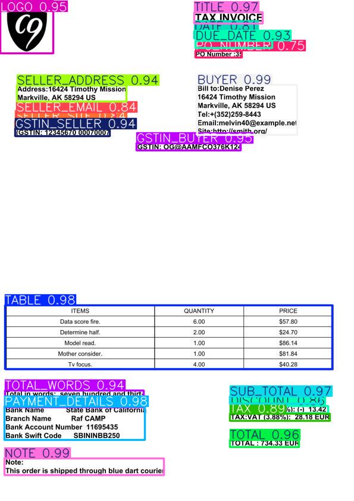

# Intelligent Invoice Data Extraction

An end-to-end invoice document-processing pipeline that combines **YOLOv8 field detection, OCR, named-entity recognition, and rule-based post-processing** to convert invoice images into structured JSON.

## Pipeline

```text
Invoice image
      ↓
YOLOv8 field detection
      ↓
Bounding-box crops
      ↓
Tesseract OCR
      ↓
spaCy NER
      ↓
Rule-based normalization
      ↓
Structured JSON
```

## What it demonstrates

- Object detection for locating invoice fields.
- OCR for reading text from detected regions.
- NER for semantic interpretation of OCR output.
- Rule-based normalization into a stable JSON schema.
- Modular Python code with a reusable package and CLI runner.
- Automated tests and GitHub Actions CI.

## Extracted information

The normalization layer supports invoice identifiers, dates, due dates, totals, subtotal, tax/GST, seller details, buyer details, and GSTIN fields.

## Repository structure

```text
.
├── src/invoice_extraction/
│   ├── __init__.py
│   ├── ocr.py
│   ├── ner.py
│   └── postproc.py
├── scripts/
│   └── run_pipeline.py
├── tests/
│   └── test_postproc.py
├── notebooks/
├── examples/
├── data/                  # local datasets, ignored by Git
├── .github/workflows/ci.yml
├── main.py                # YOLO training entry point
├── requirements.txt
└── README.md
```

## Setup

Create a virtual environment and install the runtime dependencies:

```bash
python -m venv .venv
pip install -r requirements.txt
```

Install the spaCy transformer model:

```bash
python -m spacy download en_core_web_trf
```

Install Tesseract OCR separately.

## Run inference

Prepare YOLO field-detection output in JSON format, then run:

```bash
python scripts/run_pipeline.py \
  --yolo-json path/to/output.json \
  --image examples/Inv1.jpg
```

On Windows, pass the Tesseract executable path when necessary:

```text
--tesseract-cmd "C:\Program Files\Tesseract-OCR\tesseract.exe"
```

## Train the detector

The training entry point is configurable:

```bash
python main.py --data path/to/dataset.yaml --epochs 1 --imgsz 640 --batch 16
```

Large datasets and trained model artifacts are intentionally kept outside the repository.

## Tests

The deterministic post-processing tests do not require the YOLO model, Tesseract, or spaCy transformer model:

```bash
PYTHONPATH=src pytest -q
```

GitHub Actions runs these tests automatically on pushes and pull requests.

## Example data

The repository contains **synthetic/demo invoices with no real personal or company information**.

Example output values are illustrative.

## Evaluation

The original project reported approximately **93% field-extraction accuracy** on its available invoice template set. This is a project-specific result and is not presented as a general benchmark.

## Sample Output

<p align="center">
  
</p>

## Sample Demo

[▶ Watch the full demo on YouTube](https://youtu.be/HOlwCRWGN5E)

## Limitations and next steps

This remains a prototype rather than a production invoice-extraction service. The most valuable next engineering steps are:

- reproducible field-level benchmarks;
- confidence scores and validation rules;
- stronger multi-template handling;
- model/data versioning;
- an API service around inference;
- containerized deployment;
- broader integration tests.

## License

MIT

## Author

Ronak Vekariya
